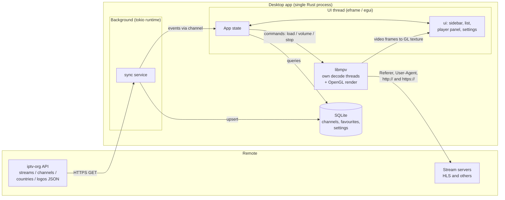
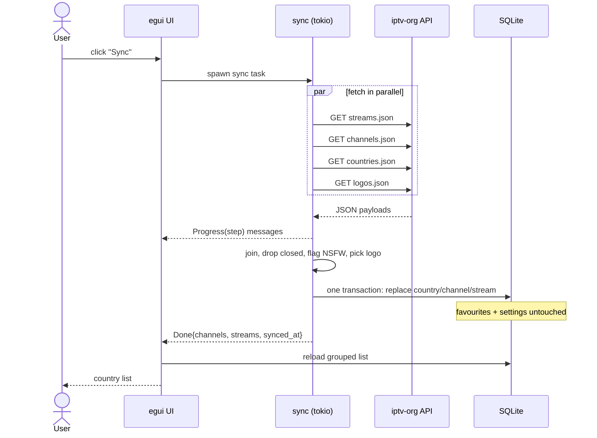
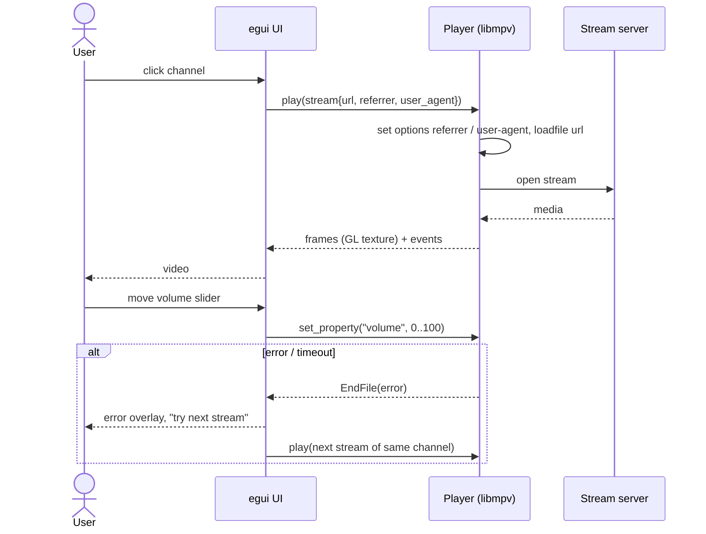
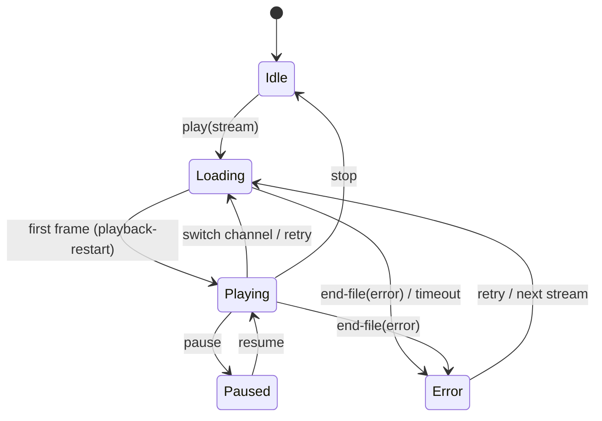
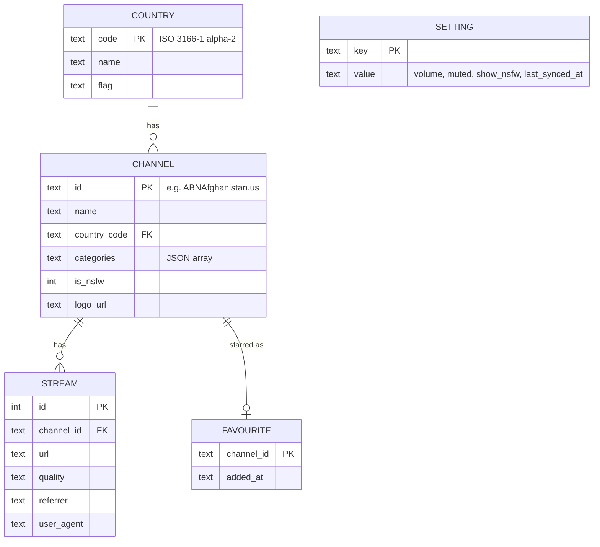
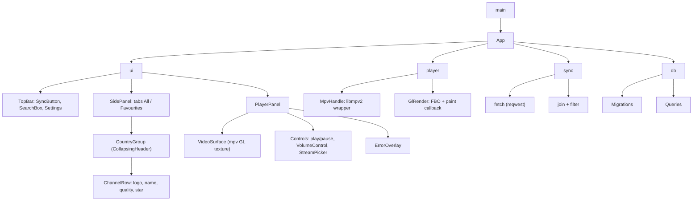

# Architecture

Diagrams use [Mermaid](https://mermaid.js.org) (rendered natively on GitHub).

## 1. System overview



The UI thread never blocks: sync runs on tokio, decoding runs on mpv's own threads, and both
notify the UI with messages plus `ctx.request_repaint()`.

## 2. Sync sequence



## 3. Playback sequence



## 4. Player state machine



## 5. Data model (SQLite)



`FAVOURITE` and `SETTING` are **never** wiped by a sync. `COUNTRY/CHANNEL/STREAM` are replaced in
one transaction. A favourite whose channel disappeared is shown greyed out ("no longer available").
Schema changes go through numbered migrations stored in `PRAGMA user_version`.

## 6. Modules and UI components



| Piece | Responsibility |
|---|---|
| `app::App` | Owns state: loaded groups, selected channel, favourites set, player status, message receivers. Implements `eframe::App::update` |
| `ui::sidebar` | Search + tabs + country groups. Only **open** groups render rows, and rows use `ScrollArea::show_rows`, so 15k channels stay fast |
| `ui::player_panel` | Video surface, play/pause, volume slider + mute, stream picker, error overlay |
| `player::MpvHandle` | Init mpv, `play(stream)`, `set_volume`, `toggle_mute`, `stop`; reads events (`playback-restart`, `end-file`) |
| `player::GlRender` | Creates mpv `RenderContext`, renders into an FBO, registers the texture with egui via a paint callback |
| `sync::run` | Fetch 4 files in parallel, join, write DB, emit progress messages |
| `db` | Open DB in the OS data dir (`directories`), migrations, `groups()`, `channels(country, q)`, `set_favourite`, settings get/set |
| `model` | `Country`, `Channel`, `Stream` and `Quality` types with `serde` derives |

Keyboard shortcuts: `Space` play/pause, `↑/↓` volume, `M` mute, `F` fullscreen, `/` focus search.

## 7. Key data structures (sketch)

```rust
struct Channel { id: String, name: String, country: String, logo: Option<String>,
                 categories: Vec<String>, is_nsfw: bool, streams: Vec<Stream> }
struct Stream  { url: String, quality: Option<String>,
                 referrer: Option<String>, user_agent: Option<String> }
enum PlayerStatus { Idle, Loading, Playing, Paused, Error(String) }
enum SyncMsg { Progress(String), Done(SyncSummary), Failed(String) }
```

## 8. Threading

- **UI thread:** egui render loop, reads DB, draws video texture.
- **tokio runtime:** sync tasks; results posted over an `mpsc` channel.
- **mpv threads:** decoding; an event callback wakes the UI.
- SQLite: one connection owned by the app; sync opens its own connection for the write
  transaction (WAL mode so the UI can keep reading).

## 9. Risks

| Risk | Mitigation |
|---|---|
| Embedding mpv video in egui (GL context sharing) | M1 spike first; fallback to a separate mpv window |
| Bundling libmpv on Windows/macOS | Decide packaging in M1; script it in M7 |
| Many dead or slow streams | Timeouts, clear error, next-stream fallback |
| Large lists slow the UI | Collapsed groups, row virtualization, lazy logo loading |
| Wayland/Linux GL quirks | Test early on a Linux VM in M1 |
| Legal/content exposure | NSFW hidden by default, honour closed channels, disclaimer in README/About |
